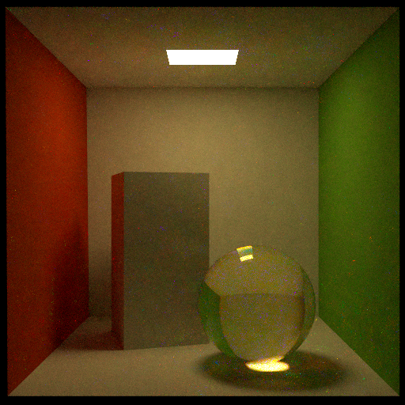
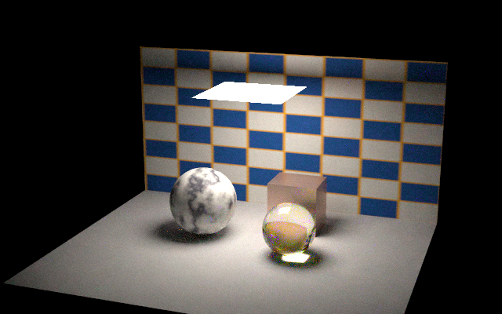
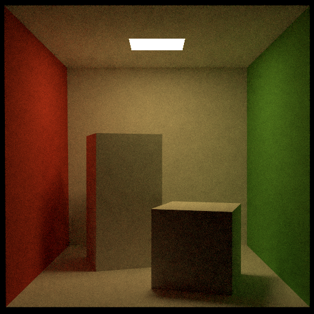
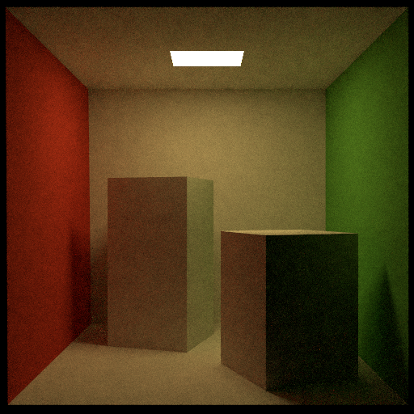

# Nora

Nora is a physically based renderer written in C99. It uses Metropolis light transport (Kelemen-style
primary sample space MLT) on top of a unidirectional path tracer with next event estimation, and renders in
either RGB or spectral mode. It has an interactive GUI built on [CUI](https://github.com/yappologistic/CUI),
a node-based shader editor that generates Open Shading Language, its own OSL-subset compiler and VM,
OBJ/MTL import and export, a scene editor (rasterized Edit mode with gizmos, undo/redo, hot reload),
JSON scene files (`.nora`), pausable renders with checkpoints (`.nrck`), and a headless CLI.

| RGB, PSSMLT | Spectral, PSSMLT (dispersive glass) |
|---|---|
|  |  |

Both images are 512 x 512 with 95 s of MLT on two aarch64 cores (`nora-cli cornell --time 95` and
`nora-cli cornell-glass --mode spectral --time 95`).



`scenes/shaderball.obj` in spectral mode. It has an image-textured backdrop, a GGX copper cube and a
dispersive glass ball from the MTL file, and `examples/shaders/marble.osl` on the left ball
(`nora-cli scenes/shaderball.obj --mode spectral --fov 22 --shader examples/shaders/marble.osl
--material Ball --time 85`).

| Built-in Cornell box | The same box edited in a `.nora` file |
|---|---|
|  |  |

[`examples/scenes/cornell_edited.nora`](examples/scenes/cornell_edited.nora) moves the tall block back and
turns it by -35 degrees, and moves, turns and stretches the short block. Both are 512 x 512 with 128
mutations per pixel (`nora-cli examples/scenes/cornell_edited.nora -o renders/edited_scene.png`; the scene
file carries the render settings).

## Features

**Light transport**
- Kelemen et al. 2002 primary sample space MLT (PSSMLT) over a path tracer with NEE and multiple
  importance sampling (power heuristic).
  - Large steps draw fresh uniform numbers; small steps use Kelemen's exponential perturbation
    (s1 = 1/1024, s2 = 1/64). Primary sample vectors are mutated lazily.
  - Bootstrap normalisation `b` from independent paths. Initial chain states are resampled from the bootstrap
    in proportion to their luminance.
  - Many independent chains (64 by default) run on worker threads. They splat expected values
    (accepted and rejected contributions weighted by `a` and `1 - a`).
- A plain progressive path tracer (`--integrator pt`). It is also the GUI's fast preview while the camera
  moves.
- Threads: pthreads on POSIX, Win32 threads on Windows, through a small shim (`src/core/nthread.c`).

**Colour**
- RGB mode: linear sRGB throughput.
- Spectral mode: hero wavelength sampling over 360 to 830 nm, with four wavelengths per path (one hero and
  three rotated companions).
  - Reflectances and emission colours are uplifted to spectra with the sigmoid-polynomial model of Jakob and
    Hanika 2019. The coefficient table is fitted at start-up (about 0.2 s) by Nora's own Gauss-Newton
    solver, so no third-party tables are used. Round-trip error is below 1% in the tests.
  - Spectra go through the CIE 1931 2-degree colour matching functions (1 nm table), then XYZ to linear sRGB.
    The white point is normalised so an RGB scene renders alike in both modes.
  - Wavelength-dependent IOR (Cauchy fit from IOR and Abbe number) collapses the path onto the hero
    wavelength, which gives real dispersion.

**Geometry and materials**
- Binned SAH BVH over triangles, Moller-Trumbore intersection.
- Materials:
  - Lambertian diffuse.
  - Conductor (smooth or rough GGX). Colours use Gulbrandsen's artist-friendly complex Fresnel
    (reflectance and edge tint), uplifted per wavelength in spectral mode.
  - Dielectric (smooth or rough GGX after Walter et al. 2007), with dispersion in spectral mode.
  - Plastic (diffuse under a GGX coat).
  - Emission on any material (one- or two-sided).
- GGX with visible normal sampling (Heitz 2018).
- Thin lens camera (aperture and focus distance).
- Output: PNG (stb_image_write from CUI's `third_party`), OpenEXR (uncompressed, 32-bit float) and PFM.
  PNG tone mapping is clamp, Reinhard or ACES, with an exposure control.

**Scenes**
- Built-in Cornell box (`cornell`), and a variant with a dispersive glass sphere (`cornell-glass`).
- OBJ/MTL import through the vendored [schmarta/obj](https://github.com/schmarta/obj) (MIT; see
  [third_party/obj/README.nora.md](third_party/obj/README.nora.md) for the fixes made to it). MTL maps to Nora
  materials as described in [MTL mapping](#mtl-mapping).
- Every object (OBJ `o`/`g` group, Cornell box part) is an instance with a translation, rotation and scale.
  Rotations are quaternions internally and Euler XYZ degrees in files and in the UI. The BVH is rebuilt over
  the transformed instances before rendering.
- [`.nora` scene files](#scene-format-nora) (JSON): referenced OBJ files, per-object transforms, materials with
  their OSL source or shader graph, the camera and the render settings. Save, load and save again gives the
  same bytes.
- Import an OBJ (with its MTL) into an open scene as new objects; export the scene as OBJ/MTL with the
  transforms baked in.

**Workflow**
- Edit mode in the GUI: a software-rasterized solid / wireframe preview, click picking, move / rotate / scale
  gizmos, numeric transforms, undo / redo, duplicate and delete. The path tracer does not run in this mode.
- Hot reload: the `.nora` file and every OBJ, MTL, `.osl` and shader graph file it uses are polled every
  0.5 s; a change reloads the scene, keeping the selection and the camera.
- Pause and resume renders without losing anything; save and resume [checkpoints](#checkpoint-format-nrck),
  also across processes from the CLI (`--checkpoint`, `--resume`, Ctrl+C safe).

## Building

You need CMake 3.16 or newer and a C99 compiler. CUI is fetched with `FetchContent`, pinned to `v1.4.0`.

```sh
cmake -S . -B build -DCMAKE_BUILD_TYPE=Release
cmake --build build -j
ctest --test-dir build --output-on-failure
```

On Linux the GUI needs `libx11-dev` and `libgl1-mesa-dev`. CUI falls back to its software renderer when
OpenGL 3.3 is not available. To build the renderer without X11:

| Option | Default | Meaning |
|---|---|---|
| `NORA_BUILD_GUI` | `ON` | Build the `nora` GUI executable (CUI window layer). `OFF` builds CUI's core only (no X11) |
| `NORA_BUILD_TESTS` | `ON` | Unit tests, CLI smoke tests, headless GUI test |
| `NORA_WITH_OSL` | `OFF` | Also build the C++17 shim for the real OpenShadingLanguage (see below) |
| `NORA_WARNINGS_AS_ERRORS` | `OFF` | `-Werror` / `/WX` |

Targets:
- `nora-cli`: the headless renderer.
- `nora`: the GUI.
- `nora_tests`: unit tests.
- `nora_gui_headless`: drives the GUI through CUI's software renderer and writes a screenshot.

## Command line

```sh
nora-cli examples/scenes/cornell_edited.nora -o edited.png        # a scene file (with its render settings)
nora-cli cornell --spp 4096 --checkpoint run.nrck --checkpoint-interval 300 -o out.exr
nora-cli cornell --resume run.nrck -o out.exr                       # finish an interrupted render
nora-cli cornell --resume run.nrck --spp 8192 -o out.exr            # or raise the target and continue
nora-cli scenes/shaderball.obj --save-scene shaderball.nora --no-render
nora-cli my.nora --export-obj baked.obj --no-render
nora-cli scene.obj --mode spectral --spp 64 -o out.png
nora-cli cornell --integrator pt --spp 256 -o out.exr -o out.png
nora-cli cornell-glass --mode spectral --time 120 --width 800 --height 800 -o glass.png
nora-cli scenes/shaderball.obj --shader examples/shaders/marble.osl --material Ball -o ball.png
nora-cli cornell --graph examples/graphs/copper.json --material White -o copper.png
nora-cli --graph examples/graphs/noisy_plastic.json --dump-osl
```

`--spp` means samples per pixel for the path tracer and mutations per pixel for MLT. Run `nora-cli --help`
for the full list: threads, size, max depth, large step probability, bootstrap and chain counts, seed,
exposure, tone mapping, field of view, aperture and focus, a constant environment light, and `--real-osl`.

OBJ files without emitters get a white constant environment light. The camera frames the scene bounds.

The scene argument is `cornell`, `cornell-glass`, an `.obj` or a `.nora` file. A `.nora` file's `render`
block sets the defaults; options on the command line override them.

| Option | Meaning |
|---|---|
| `--checkpoint FILE` | Write a `.nrck` checkpoint when the render ends, when it is interrupted with Ctrl+C (SIGINT; the image is written too and the exit code is 130), and every `--checkpoint-interval` seconds |
| `--checkpoint-interval S` | Seconds between periodic checkpoints (default 0: only at the end and on SIGINT) |
| `--resume FILE` | Continue a checkpoint. Refused when the scene's hash differs from the one saved. Image size, mode, integrator, depth, seed and chain count come from the checkpoint; `--spp` is the new total target (default: the checkpoint's), `--time` limits this run, `--threads` may differ |
| `--save-scene FILE` | Write the scene with the effective render settings as a `.nora` file |
| `--export-obj FILE` | Write OBJ + MTL (next to it) with the object transforms baked in |
| `--no-render` | Stop after `--save-scene` / `--export-obj` |

## GUI

```sh
nora                      # Cornell box with the glass sphere
nora scenes/shaderball.obj
nora examples/scenes/cornell_edited.nora
```

The window has a menu bar (CUI's menu bar component) over a CUI dockspace whose tabs can be re-docked.

| Menu | Items |
|---|---|
| File | Open Scene (`.nora` or `.obj`, replaces the scene), Import Object (merges an OBJ and its MTL as new objects), Save Scene, Save Scene As, Export OBJ (transforms baked in), Save Image, Save Checkpoint, Resume from Checkpoint |
| Edit | Undo, Redo, Duplicate, Delete |
| View | Edit mode, Render mode, Wireframe, Move / Rotate / Scale gizmo, Frame scene |
| Render | Render, Pause, Resume, Stop |

File actions use the native file dialog (CUI). Without one (headless), they use the path fields under
*Files* in Render Settings.

The panels are:
- **Viewport**, with an *Edit / Render* switch above it.
  - **Render mode**: the progressive render, drawn as a texture on a CUI canvas. While the camera moves, a
    low-resolution path traced preview runs. Half a second after it stops, Nora switches to progressive MLT
    at full resolution (this can be turned off in Render Settings). A click picks the object under the
    mouse with a ray through the BVH. *Pause* / *Resume* appear next to the switch during a render.
  - **Edit mode**: no path tracing. Nora's own triangle rasterizer with a z-buffer
    ([src/core/raster.c](src/core/raster.c)) draws a flat-shaded preview, optionally with wireframe, into an
    RGBA image that goes through the same texture path as the render, so it also works with CUI's software
    renderer. It also writes an object ID buffer: a click selects the object under the mouse, a click on
    the background clears the selection. The selected object is tinted and outlined and gets a gizmo:
    - Move (`W`): drag an arrow to move along that world axis.
    - Rotate (`E`): drag a ring to turn around that world axis; the object follows the mouse.
    - Scale (`R`): drag a handle to scale along that axis of the object.
    Each drag is one undo step. Switching to Render (or starting a render) applies the transforms and
    rebuilds the BVH.
  - Camera (both modes): left drag orbits (in Edit mode: starting on empty space or the selected object,
    not on a gizmo handle), Shift+left or middle drag pans, right drag (or Ctrl+left) dollies. `+`/`-` zoom,
    the arrow keys orbit, `F` frames the scene. CUI 1.4 does not pass mouse wheel events to custom
    canvases, so zoom uses drags and keys.
- **Outliner**: objects and materials. Selecting an object selects its material.
- **Properties**: the selected object's location, rotation (degrees, XYZ order) and scale as number fields
  (typing into them within a second is one undo step), Duplicate, Delete and Reset; then the material:
  type, colours, roughness, IOR, Abbe number and emission. Changes restart the preview.
- **Node Editor**: CUI's node editor, holding the shader graph of the selected material.
  - Node types:
    - Inputs: Geometry, Value, RGB.
    - Math, with 12 operations.
    - Mix Color.
    - Textures: Image, Noise (fBm), Checker.
    - Closures: Diffuse BSDF, Microfacet GGX (reflect, refract, or both), Reflection, Refraction, Emission,
      Transparent, Add Shader and Mix Shader.
    - Material Output.
  - Unlinked inputs show a slider or colour picker inside the node.
  - Graphs save and load as JSON. *Compile & assign* generates OSL, compiles it and assigns it to the
    material; the graph is stored with the material in the `.nora` file.
- **OSL Source**: the generated OSL in CUI's code editor. It is live and editable: edits are checked with
  the built-in compiler as you type and can be assigned to the material.
- **Render Settings**:
  - Render, Pause / Resume, Stop, Save image (PNG, EXR or PFM), Save checkpoint, Resume from checkpoint.
  - RGB or spectral mode, MLT or PT.
  - Large step (mutation) probability, mutations or samples per pixel, time limit, threads, depth and
    resolution. Raising the samples of a paused or finished render and pressing Resume continues it.
  - Exposure and tone mapping.
  - *Files*: the hot reload switch (on by default) and the paths used without a file dialog.
- **Log**: renderer, compiler, edit and reload messages.

### Hotkeys

| Key | Action |
|---|---|
| `Ctrl+O` | Open Scene |
| `Ctrl+I` | Import Object |
| `Ctrl+S` / `Ctrl+Shift+S` | Save Scene / Save Scene As |
| `Ctrl+Z` | Undo (transforms, imports, duplicates, deletes) |
| `Ctrl+Y` or `Ctrl+Shift+Z` | Redo |
| `Tab` (viewport) | Toggle Edit / Render mode |
| `W` / `E` / `R` (viewport) | Move / Rotate / Scale gizmo |
| `Shift+D` or `Ctrl+D` (viewport) | Duplicate the selected object |
| `Delete` or `X` (viewport) | Delete the selected object |
| `Esc` (viewport) | Clear the selection |
| `F` (viewport) | Frame the scene |
| `+` / `-`, arrow keys (viewport) | Zoom, orbit |
| `F12` | Render |

On macOS, Ctrl is Command.

### Hot reload

With *Hot reload* on, Nora polls the modification time and size of the scene's files about every 500 ms:
the `.nora` file, the OBJ files and their MTL libraries, `.osl` files and shader graph files. When one
changes:
- the `.nora` file itself: the scene is loaded from it again;
- anything else: the current scene (with its unsaved edits) is written to memory as a `.nora` document and
  read back, which re-reads every referenced file; materials of an OBJ whose MTL changed take the new MTL
  values.

The selected object (by name) and the camera are kept, a line goes to the Log, the undo history is cleared
and the preview restarts (a running final render restarts as a final render). Nora's own saves do not
trigger a reload. If the file cannot be loaded (for example half written) the current scene stays and the
next change is picked up. The detection logic is unit tested with an injected file system (`watch` test).

## Open Shading Language

Nora supports OSL in two layers.

### (a) Built-in OSL-subset compiler (`src/osl`, C99, always on)

This is a lexer, a recursive descent parser, a type checker and a code generator for a register bytecode,
plus a VM. Shaders run per shading point on every render thread, each thread with its own VM state, in both
RGB and spectral modes. Closure weights are RGB and are uplifted to spectra at the BSDF.

Supported:

| Area | Coverage |
|---|---|
| Declarations | `surface` (also `shader`) with parameters and defaults; defaults may use globals and earlier parameters; `output` parameters; metadata `[[ ... ]]` is skipped; `#include` lines are ignored |
| Types | `float`, `int`, `color`, `point`, `vector`, `normal`, `string`, `closure color`, `void` (functions) |
| Expressions | arithmetic with float/triple broadcast, `%`, comparisons, `&&` `\|\|` `!` (short circuit), ternary, compound assignment, `++`/`--`, casts, component access `c[i]` (constant or computed), type constructors including `color("hsv", h, s, v)` |
| Statements | blocks with scoping, `if`/`else`, `for`, `while`, `do`/`while`, `break`, `continue`, `return` |
| Functions | user functions (inlined, `output` parameters by reference, recursion is reported) |
| Globals | `P I N Ng dPdu dPdv u v time Ci`, plus `M_PI` and the other math constants |
| Math library | `sin cos tan asin acos atan atan2 sinh cosh tanh sqrt inversesqrt exp exp2 log log2 log10 pow abs fabs floor ceil round trunc sign mod fmod min max clamp mix step smoothstep radians degrees hypot isnan isinf` |
| Geometry library | `dot cross length distance normalize faceforward reflect refract luminance transform` (identity: Nora shades in world space) `backfacing raytype` |
| Noise and textures | `noise snoise cellnoise` and `noise("perlin"/"uperlin"/"cell"/"simplex", p[, t])`, float or colour by context; `texture(file, s, t, ...)` through the host (bilinear, wrapping, `t = 0` at the top) |
| Closures | `diffuse`, `oren_nayar` (as diffuse), `microfacet("ggx", N, alpha, eta, refract)` and the 7-argument anisotropic form (averaged), `reflection(N[, eta])`, `refraction(N, eta)`, `emission()`, `transparent()`; `holdout` and `background` compile to nothing; closures add and scale by colours and floats |
| Diagnostics | `line:col: error: ...` for syntax and type errors; runtime guard against infinite loops |

Not supported: arrays, structs, matrices, `getattribute`, `pnoise` and other noise variants, derivatives
(`Dx`, `Dy`, `area`, `calculatenormal`), message passing, string functions, displacement, volume and light
shaders, and closures other than those listed. `N` is face-forwarded toward the viewer as in OSL's
testrender, so refractive shaders should use `backfacing() ? 1/eta : eta`, as the example shaders do.
`emission()` is treated as radiance equal to its weight.

Example shaders are in [examples/shaders](examples/shaders): `plastic`, `glass`, `checker`, `emissive`,
`marble` (a user function and loops), `brushed_metal` and `textured`. The test suite has about 200 checks
for the compiler and VM (`nora_tests osl`).

### (b) Real OSL through liboslcomp and liboslexec (`-DNORA_WITH_OSL=ON`, optional)

`src/osl/real/osl_real.cpp` is a C++17 shim behind a small C ABI (`osl_real.h`). With OpenShadingLanguage
found by `find_package(OSL CONFIG)`, it:
- compiles source with `OSLCompiler::compile_buffer`,
- loads it with `ShadingSystem::LoadMemoryCompiledShader`,
- builds a shader group and executes it per shading point (a thread-local `ShadingContext`),
- walks the `Ci` closure tree into Nora's closure list.

It registers `diffuse`, `oren_nayar`, `microfacet`, `reflection`, `refraction`, `emission` and
`transparent`. `nora-cli --real-osl` enables it (the GUI and the CLI fall back to the built-in compiler when
a shader fails).

If the flag is on but OSL is not found, the shim compiles as a stub and reports that it is unavailable, so
the flag never breaks a build. The default build never needs C++, LLVM or OSL.

Status: the stub mode is built and tested in CI. The real mode is a best-effort implementation against the
OSL 1.12/1.13 API and has not been compiled yet: OSL is not packaged for the CI runners (Ubuntu 24.04 apt,
Homebrew, conda-forge), and building it with LLVM was out of scope for 0.1.

## Scene format (.nora)

A `.nora` file is UTF-8 JSON. Paths are relative to the `.nora` file (absolute paths also work). Nora
writes it in a fixed layout with floats at 9 significant digits, so save, load and save again gives the
same bytes (unit tested for the Cornell boxes, an OBJ with MTL, textures and OSL files, inline OSL, inline
graphs, imported and transformed objects).

```json
{
  "format": "nora-scene",
  "version": 1,
  "name": "Cornell box (edited)",
  "sources": [
    { "type": "builtin", "name": "cornell" },
    { "type": "obj", "path": "../../scenes/shaderball.obj" }
  ],
  "objects": [
    { "name": "Tall block", "source": 0, "mesh": 6,
      "translation": [0, 0, 40], "rotation": [0, -35, 0], "scale": [1, 1, 1] },
    { "name": "Ball", "source": 1, "mesh": 2,
      "translation": [0, 0, 0], "rotation": [0, 0, 0], "scale": [80, 80, 80] }
  ],
  "materials": [
    { "name": "White", "type": "diffuse",
      "color": [0.725, 0.71, 0.68], "edge_tint": [1, 1, 1], "roughness": 0, "ior": 1.5, "abbe": 0,
      "emission": [0, 0, 0], "emission_strength": 0, "two_sided": false },
    { "name": "Panel", "type": "diffuse", "color": [1, 1, 1], "...": "...",
      "color_texture": "../../scenes/grid.png" },
    { "name": "Ball", "type": "plastic", "...": "...",
      "shader": { "name": "Ball", "osl_file": "../shaders/marble.osl" } }
  ],
  "camera": { "position": [278, 273, -800], "target": [278, 273, 0], "up": [0, 1, 0],
    "fov": 39.3077, "aperture": 0, "focus_distance": 0 },
  "environment": [0, 0, 0],
  "render": { "width": 512, "height": 512, "mode": "rgb", "integrator": "mlt", "spp": 128,
    "max_depth": 10, "large_step_probability": 0.3, "bootstrap": 100000, "chains": 64, "seed": 1, "time_limit": 0 }
}
```

| Key | Meaning |
|---|---|
| `sources[]` | Geometry: `{"type": "obj", "path": ...}` or `{"type": "builtin", "name": "cornell" \| "cornell-glass"}`. Each is loaded once |
| `objects[]` | One instance each. `source` indexes `sources`, `mesh` is the object's index in that source (OBJ `o`/`g` groups in file order); if it is out of range the object is looked up by `name`. Several objects may use the same source mesh (duplicates) |
| `translation` | World-space offset |
| `rotation` | Euler angles in degrees, XYZ order: rotate about X, then Y, then Z (fixed axes), R = Rz Ry Rx. Stored as a quaternion internally |
| `scale` | Per-axis scale in the object's own frame |
| | World position = pivot + translation + R (scale * (p - pivot)), where the pivot is the centre of the object's untransformed bounds |
| `materials[]` | Matched to the sources' materials by name; the file wins. `type`: `diffuse`, `conductor`, `dielectric`, `plastic`. Optional `color_texture` |
| `shader` | Optional. One of `osl_file` (an `.osl` file), `osl` (inline source), `graph_file` (a shader graph `.json`) or `graph` (the shader graph JSON inline) |
| `camera` | Pinhole or thin lens; `fov` is vertical, in degrees |
| `environment` | Constant environment radiance |
| `render` | Optional render settings (see `nora-cli --help`) |

Objects deleted in the editor are not written. A source is written once even when it was imported twice.

## Checkpoint format (.nrck)

A checkpoint holds everything a paused PSSMLT or PT render needs to continue as if it had never stopped:
with the same thread count, N mutations, a checkpoint and M more equal N + M mutations in one go up to
float summation order (tested in process and across CLI runs, within 0.1%). It is little-endian binary:

| Field | Type |
|---|---|
| magic `NRCK` | 4 bytes |
| version (1) | u32 |
| scene hash: FNV-1a 64 over the transformed geometry, normals, UVs, materials, shader sources, textures, camera and environment | u64 |
| width, height, mode, integrator, spp, max depth | 6 x i32 |
| large step probability | f32 |
| bootstrap paths, chain count | 2 x i32 |
| seed | u64 |
| normalisation constant `b` | f64 |
| mutations or samples done; PT rows claimed; accepted; proposed | 4 x i64 |
| elapsed seconds | f64 |
| channel count (3), then the film: width x height x 3 sums (all threads added) | u32, f32[] |
| PT only: samples per pixel | f32[width x height] |
| chain count n (0 for PT, or before the MLT bootstrap has finished) | i32 |
| per chain: PCG32 state and increment (u64 x 2); iteration and last large step (i64 x 2); large step flag and sample index (i32 x 2); current contribution RGB, its luminance and film position (f32 x 6); mutations done (i64); sample vector length m (i32); m x (value, backup as f32; modified-at, backup as i64) | |
| chains ready flag | i32 |
| end marker `0x454e4421` | u32 |

Resuming refuses a checkpoint whose scene hash differs from the current scene (any moved object, material
or camera change), whose version is unknown, or that is truncated. A checkpoint saved during the MLT
bootstrap resumes by redoing the bootstrap. Pause is separate from Stop: pause keeps the chains, their RNG
and sample state and the film in memory, and Resume continues accumulating; Stop ends the render.

## Shader graph JSON

```json
{
  "format": "nora-shader-graph",
  "version": 1,
  "nodes": [ { "id": 2, "type": "microfacet", "x": 340, "y": 100, "op": 0, "text": "",
               "values": [[1, 1, 1], [0.35, 0, 0], [0, 0, 0], [0, 0, 0]] } ],
  "links": [ { "from": [3, 0], "to": [2, 0] } ]
}
```

`values` holds the unlinked input values in input order, and `op` is the operation index (Math, Microfacet).
A link goes from `[node, output slot]` to `[node, input slot]`.

## MTL mapping

| MTL | Nora |
|---|---|
| `d < 1`, `Tr > 0`, `Tf < 1` or `illum` 4/6/7/9 | dielectric: `Ni` is the IOR, `Tf` the tint, `Pr` the roughness |
| `Pm >= 0.5` or `illum 3` | conductor: `Ks` (else `Kd`) is the reflectance; roughness from `Pr`, else from `Ns` |
| `Ks > 0` with `illum >= 2` | plastic: `Kd` base and a GGX coat (`Ni`, `Ns`/`Pr`) |
| otherwise | diffuse `Kd` |
| `Ke` | emission (two-sided) |
| `map_Kd` | albedo texture (PNG, JPEG, HDR) |
| `nora_type`, `nora_abbe`, `nora_roughness`, `nora_edge r g b`, `nora_shader file.osl` | Nora extensions |

## Tests

`ctest` runs:
- `spectrum`: uplift round trip, CMFs, white normalisation.
- `bsdf`: Fresnel, GGX normalisation, furnace and energy tests, sample/eval consistency.
- `bvh`: against brute force.
- `obj`: quads, negative indices and every index form, MTL mapping.
- `osl`: about 200 checks.
- `graph`: every node type compiles, JSON round trip, cycles.
- `render`:
  - MLT agrees with the path tracer within 8%, and spectral with RGB within 5%.
  - Determinism, the async API, EXR/PFM/PNG writing.
- `scenefile`: save / load / save gives identical text for the Cornell boxes, an OBJ with MTL, a texture and
  OSL files, inline OSL, an inline shader graph, imported and transformed objects; the same scene hash after
  a round trip; error handling; scene dependencies; OBJ export with baked transforms reloads with the same
  bounds and lights.
- `edit`: transforms, duplicate, delete and their undo / redo; Euler and quaternion round trips.
- `watch`: hot reload detection with an injected file system (polling interval, new mtime, new size,
  deleted and recreated files, each change reported once) and with real files; path helpers.
- `raster`: the Edit mode rasterizer and its ID buffer (picking, hidden objects, near-plane clipping).
- `checkpoint`: N + checkpoint + M equals N + M (MLT and PT) within 0.1% while an independently seeded
  render differs by more than 1%; pausing repeatedly mid-render; a checkpoint taken mid-render resumes in
  another renderer; a changed scene and garbage files are refused.
- `gui_headless`: builds every panel with CUI's software renderer, previews and renders with MLT, assigns a
  graph shader, saves; then the editing workflow with injected mouse and key events: Edit mode, picking by
  click, gizmo drags (move, rotate, scale), Ctrl+Z / Ctrl+Y, Shift+D, Delete, import and its undo, saving a
  `.nora` file, editing it on disk and hot reloading (and not with hot reload off), opening it, OBJ export,
  pause / resume / checkpoint / resume from checkpoint, and a refused checkpoint of another scene. Writes
  `gui_headless.png` and `gui_headless_edit.png`.
- `cli_checkpoint`: across processes: render, checkpoint, resume in a new process with another thread count,
  compare with a direct render; a checkpoint of another scene is refused; periodic checkpoints; PT.
- `cli_scene_file`: a saved `.nora` renders like the built-in scene, moving an object in the file changes the
  image, OBJ export.
- Five CLI smoke renders, among them an OBJ with an OSL shader and a shader graph.

## Roadmap

- **Multiplexed MLT over bidirectional path tracing (MMLT/BDPT).** Not implemented yet. The lazy primary
  sample space sampler, the bootstrap and the splatting would carry over; BDPT itself (light subpaths,
  connection MIS) and per-strategy stream splitting are the missing parts.
- Mouse wheel zoom once CUI exposes scroll input to canvases.
- Environment maps with importance sampling; more light types.
- OSL: arrays, matrices, `getattribute`, derivatives.
- Texture filtering (MIP maps), normal maps.
- Selecting several objects at once; parenting.
- Picking against a top-level BVH over instances instead of re-transforming vertices (fine for the scene
  sizes Nora targets today).

## License

Nora is MIT licensed (see [LICENSE](LICENSE)). Third-party parts:
- [CUI](https://github.com/yappologistic/CUI), MIT. It is fetched at configure time; its stb headers
  (public domain or MIT) are used for PNG writing and image loading.
- [obj](https://github.com/schmarta/obj), MIT, Copyright (c) 2024 Lucas Marta. Vendored in
  `third_party/obj`, with changes.
- CIE 1931 2-degree colour matching functions: public CIE standard data.
